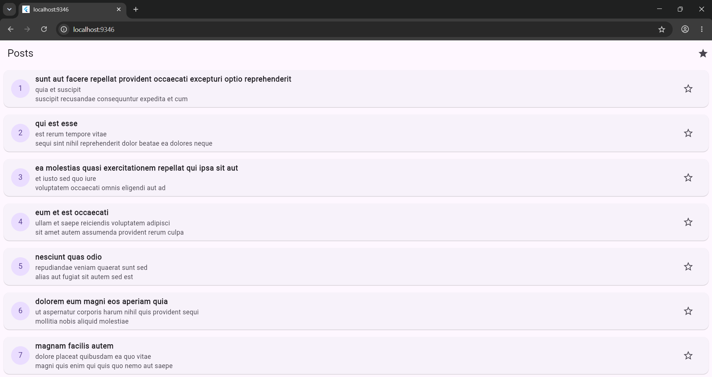
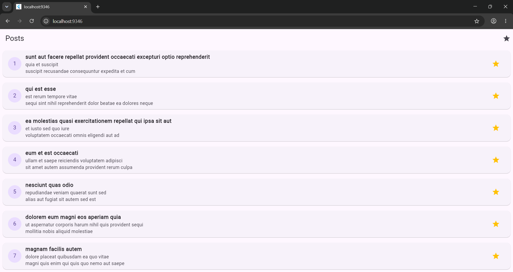
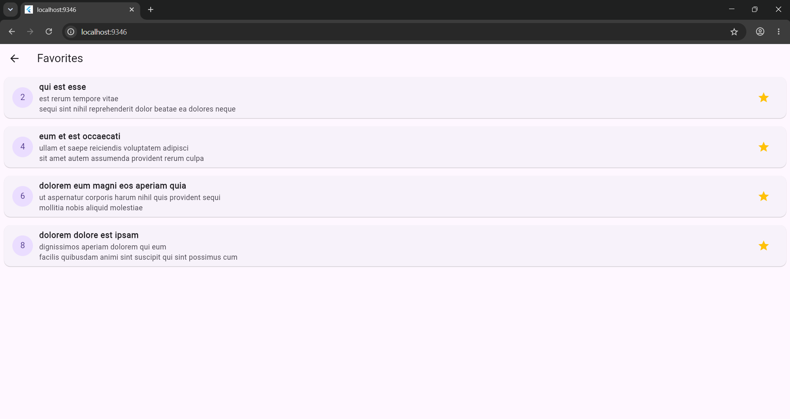
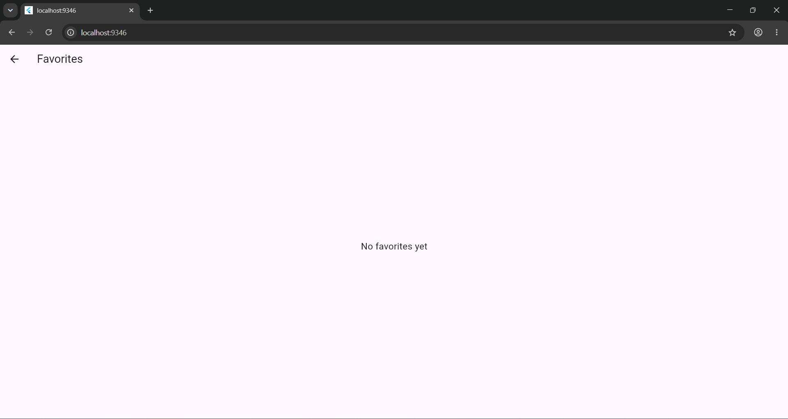
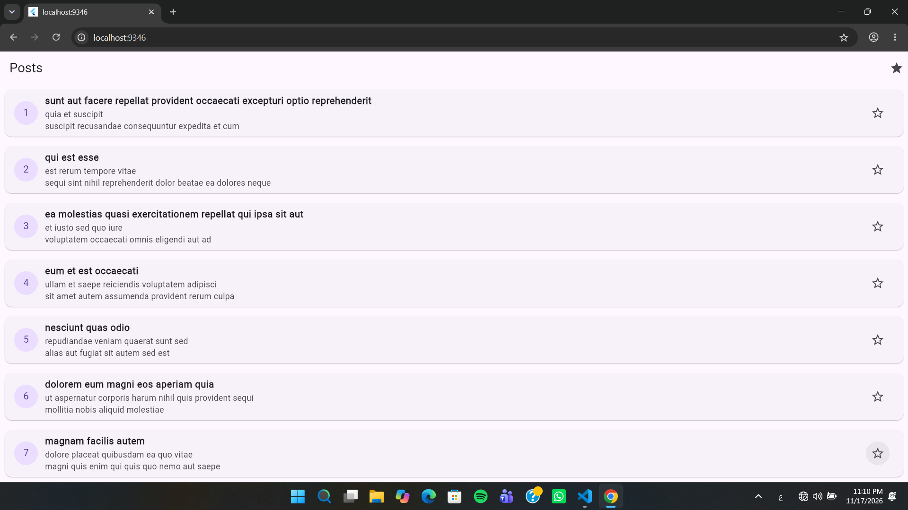
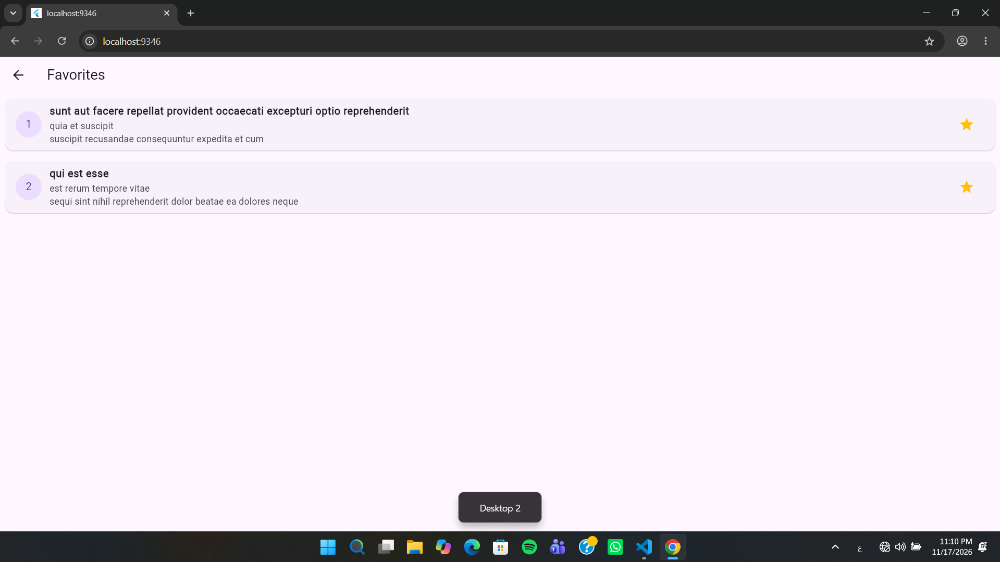
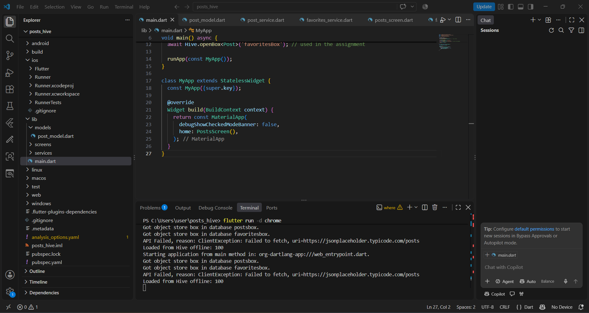

# Offline Posts App (Hive)

A Flutter app that fetches posts from [JSONPlaceholder](https://jsonplaceholder.typicode.com/posts), caches them locally with **Hive**, and lets the user save favorite posts in a separate Hive box. The app keeps working without internet.

## Features

- Posts list loaded from the API and cached in `postsBox`
- Offline mode: the last saved posts are shown when there is no internet
- Error message when there is no internet and no cached data
- Favorites saved in their own box (`favoritesBox`), so they survive refreshes and app restarts
- Star icon on every post (filled = favorite, outlined = not favorite), updated immediately
- Favorites screen opened from the AppBar, with a "No favorites yet" message when empty

## Project Structure

```
lib/
├── main.dart                      # initialises Hive, registers adapter, opens boxes
├── models/
│   └── post_model.dart            # Post class + Hive adapter
├── services/
│   ├── post_service.dart          # API first, Hive as a fallback
│   └── favorites_service.dart     # toggleFavorite, isFavorite, getFavorites
└── screens/
    ├── posts_screen.dart          # posts list + star button + Favorites button
    └── favorites_screen.dart      # saved favorites
````
## How It Works
````
- **PostService.getPosts()** tries the API first. On success it clears `postsBox`, saves the new posts and returns them. On failure it returns the cached posts from Hive, or throws "No Internet and No Cached Data" if the box is empty.
- **FavoritesService** stores a copy of each favorite post in `favoritesBox` using the post `id` as the key. A copy is saved because a `HiveObject` can only live in one box at a time.
- Favorites use a separate box because `getPosts()` clears `postsBox` on every refresh, which would otherwise wipe the favorites.
- The UI listens to `favoritesBox` with `ValueListenableBuilder`, so the stars and the Favorites screen update instantly.

## Screenshots

### 1. Posts loaded online


### 2. Favorite toggle (filled / outlined star)


### 3. Favorites screen


### 4. Empty favorites message


### 5. Posts loaded offline (network disconnected)


### 6. Favorites still available offline


### 7. Console output when loading from Hive


## Offline Test

1. Ran the app with internet and marked several posts as favorites.
2. Disconnected the network from the laptop.
3. Refreshed the app: the posts were loaded from Hive and the favorites were still there.

## Run the Project

```
flutter pub get
dart run build_runner build --delete-conflicting-outputs
flutter run -d chrome
```
